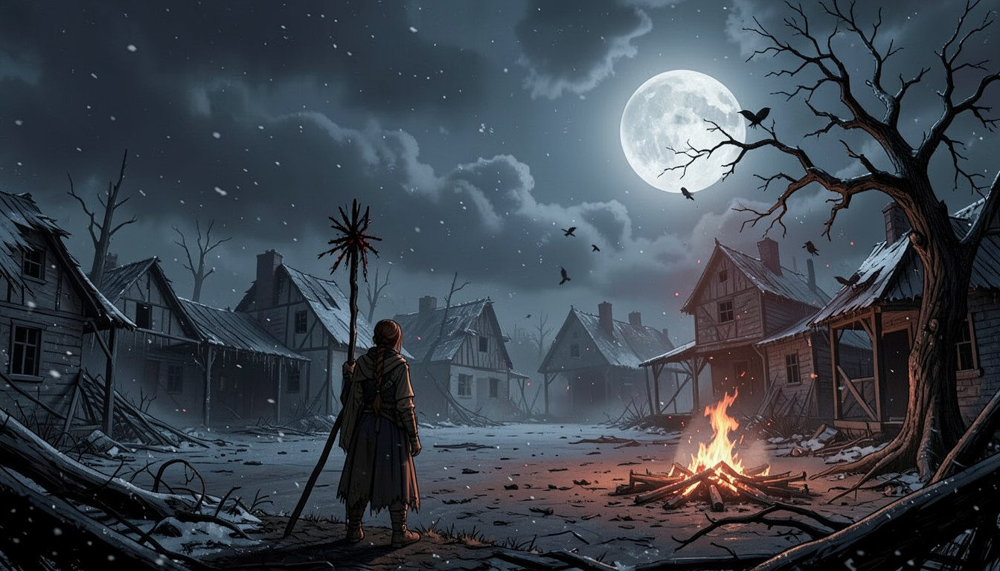
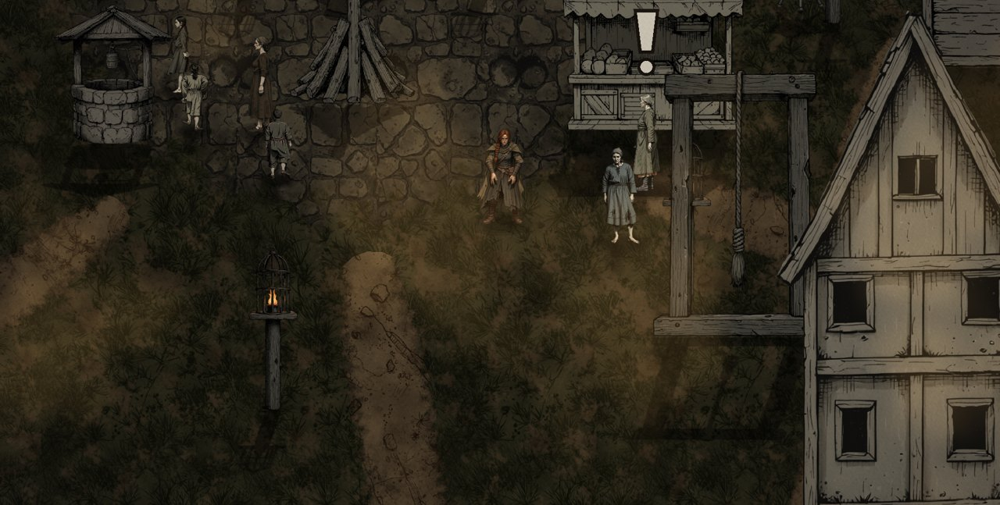
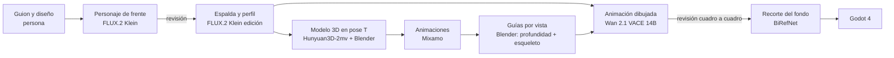

  <picture>
    <source media="(prefers-color-scheme: dark)" srcset="media/logo_blanco.png">
    
  </picture>

<i>Never ordinary, never average.</i>

---

## Embers Remain

**Valdren, año 312 de la Llama.** Maelis vuelve al brezal donde ardieron las hogueras. Un RPG oscuro de
exploración y combate con estética de ilustración en tinta, donde cada pueblo guarda lo que el fuego no pudo borrar.

- **Combate:** cuerpo a cuerpo en tiempo real, con un combo de tajo, estocada y patada, golpe pesado, esquiva,
  bloqueo y contragolpe. Cada enemigo tiene su forma de atacar y de caer, y los jefes tienen fases propias.
- **Oficios:** técnicas de 15 oficios distintos (guerrera, cazadora, hechicera, juglaresa, alquimista…).
- **Mundo:** compañeras que se unen al viaje, misiones que cambian el pueblo, día y noche, clima, interiores con
  varios pisos, pesca, forja y otros oficios.

**Estado:** en desarrollo. Se descarga desde el NONA Launcher.

---

## Un experimento: guion humano, arte y animación con IA

Embers Remain es también una prueba: **¿hasta dónde se puede llegar animando y dibujando un juego entero con
IA, cuando la historia, los personajes y el diseño los escribe una persona?**

La parte humana es el **guion, los personajes, los diálogos, el diseño del juego y la dirección de arte**: qué
debe verse, qué está bien y qué hay que rehacer. Cada imagen y cada animación pasa por esa revisión antes de
entrar al juego. La IA corre en local, en una sola PC, con [ComfyUI](https://github.com/comfyanonymous/ComfyUI).

**1. Personajes.** Del guion sale la descripción de cada personaje y FLUX.2 Klein (4B) dibuja su versión de
frente. Recién cuando la persona la aprueba, el mismo modelo, en modo edición, hace la espalda y el perfil a partir
de esa imagen, para que el diseño no cambie.
`UNETLoader → CLIPLoader (Qwen3 4B) → ReferenceLatent (imagen aprobada) → Flux2Scheduler (4 pasos) → SamplerCustomAdvanced → VAEDecode`

**2. Esqueleto en 3D.** Con las tres vistas, Hunyuan3D-2mv arma un modelo 3D en pose T que se limpia en Blender y
se sube a Mixamo para darle las animaciones (caminar, correr, golpes, muertes…).

**3. Guías.** Un script de Blender renderiza cada animación desde las tres cámaras del juego (frente, espalda y
perfil puro) como video de **profundidad** y esqueleto. Si el personaje lleva un arma, la espada va atada al hueso
de la mano en el 3D para que la guía ya la muestre en su lugar.

**4. Animación.** Wan 2.1 VACE 14B toma el video guía y la imagen del personaje, y dibuja la animación en el estilo
del juego, cuadro por cuadro.
`UnetLoaderGGUF (Wan 2.1 VACE 14B Q4) + LoRA lightx2v → CLIPLoader (UMT5-XXL) → LoadVideo (guía) + LoadImage (personaje) → WanVaceToVideo → ModelSamplingSD3 → KSampler (6 pasos) → TrimVideoLatent → VAEDecode → SaveImage`

**5. Revisión y juego.** Cada tanda se mira en video: cuerpo fuera de cuadro, manos o caras que cambian, armas
que flotan… Lo que falla se rehace con otra semilla o con el pedido corregido. Lo aprobado se recorta con BiRefNet
y pasa a Godot, que arma cada personaje con sus animaciones en las tres vistas.

**Lo que aprendimos hasta ahora**
- La IA respeta mucho más una **forma en la guía** que una descripción en el texto: la espada salió bien recién
  cuando estuvo en el 3D, no cuando se la pedía con palabras.
- Pedir las otras vistas **a partir de una imagen ya aprobada** mantiene el diseño; pedirlas desde cero lo cambia.
- La revisión humana no se puede saltear: buena parte de lo generado se rehace al menos una vez.

---

© 2026 NONA Studio. Todos los derechos reservados. Este repositorio es solo una vitrina: las imágenes, el arte,
los textos, los personajes y los nombres «NONA Studio» y «Embers Remain» son propiedad de NONA Studio. No se permite
copiarlos, redistribuirlos ni usarlos sin autorización escrita. El código y los juegos no se publican aquí.
