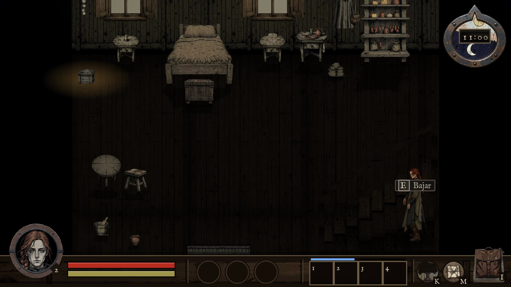
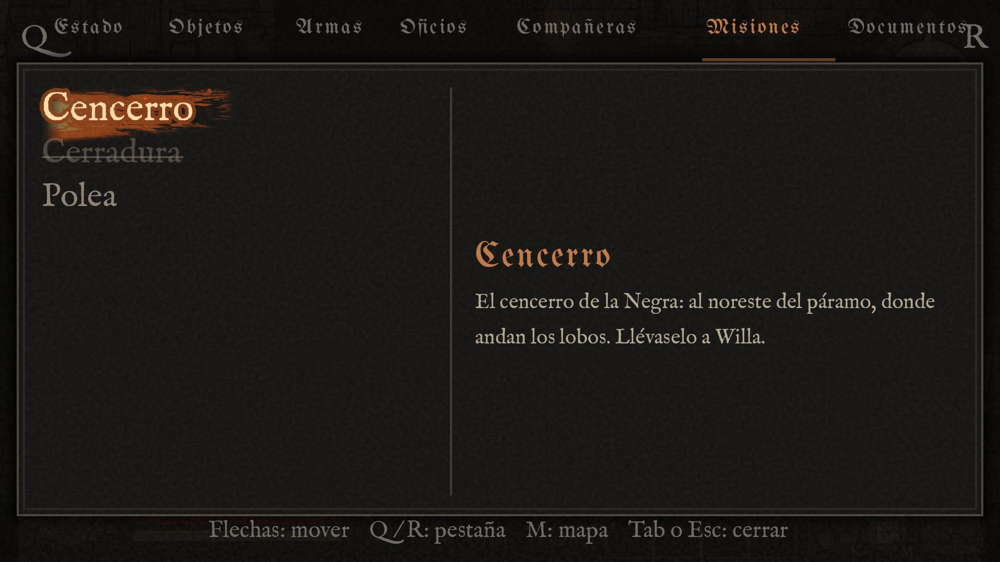
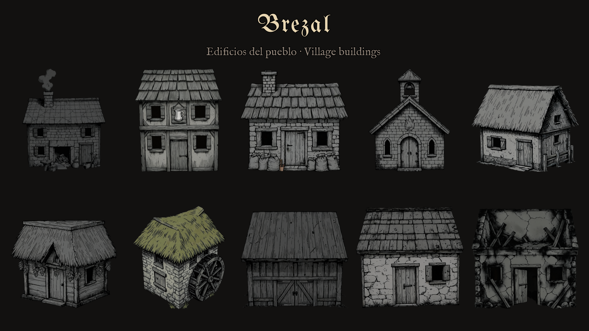

<b>Español</b> · <a href="README_en.md">English</a>

# Embers Remain

**Valdren, año 312 de la Llama.** Maelis vuelve al brezal donde ardieron las hogueras. Un RPG oscuro de exploración
y combate con estética de ilustración en tinta, hecho en **Godot 4**.

**Estado:** el primer capítulo (Acto I) se puede jugar de principio a fin. La versión 1.0 incluirá los tres actos.

## El juego

- **Combate** cuerpo a cuerpo en tiempo real: combo de tajo, estocada y patada, golpe pesado, esquiva, bloqueo y
  contragolpe. Cada enemigo ataca y cae a su manera, y los jefes tienen fases propias.
- **Un pueblo vivo:** día y noche, clima, misiones que cambian el lugar, interiores con varios pisos, pesca y forja.
- **Interfaz:** botones flotantes con la acción posible ([E] Hablar, Subir, Leer…), avisos de misión y de objetos, y
  misiones terminadas tachadas en la mochila.

| De día | De noche |
|---|---|
|  |  |
| **Interiores con varios pisos** | **Combate** |
|  |  |

## Cómo se hizo: guion humano, arte y animación con IA

Embers Remain es también un experimento: **¿hasta dónde se puede llegar dibujando y animando un juego entero con
IA, cuando la historia, los personajes y el diseño los escribe una persona?** Todo corre en local, en una sola PC.

1. **Personajes.** Del guion sale cada personaje de frente (FLUX.2 Klein). Recién cuando se aprueba, el mismo
   modelo en modo edición hace la espalda y el perfil a partir de esa imagen, para que el diseño no cambie.
2. **Esqueleto en 3D.** Con las tres vistas se arma un modelo en pose T (Hunyuan3D-2mv + Blender) y se anima con
   Mixamo.
3. **Guías.** Blender renderiza cada animación desde las tres cámaras del juego como video de profundidad y
   esqueleto.
4. **Animación.** Wan 2.1 VACE 14B toma la guía y la imagen del personaje y dibuja la animación cuadro por cuadro.
5. **Revisión.** Cada tanda se mira en video; lo que falla se rehace. Lo aprobado se recorta y entra a Godot.

**Videos:** [tráiler](media/embers_remain_trailer.mp4) · [caminar y correr](media/maelis_caminar_y_correr.mp4) ·
[personajes](media/personajes_acto1.mp4)

### Lo que aprendimos

- La IA respeta mucho más una **forma en la guía** que una descripción en el texto.
- Pedir las otras vistas **a partir de una imagen ya aprobada** mantiene el diseño; pedirlas desde cero lo cambia.
- La revisión humana no se puede saltear: buena parte de lo generado se rehace al menos una vez.

---

© 2026 NONA Studio. Todos los derechos reservados. Las imágenes, el arte, los textos, los personajes y los
nombres «NONA Studio» y «Embers Remain» son propiedad de NONA Studio.
