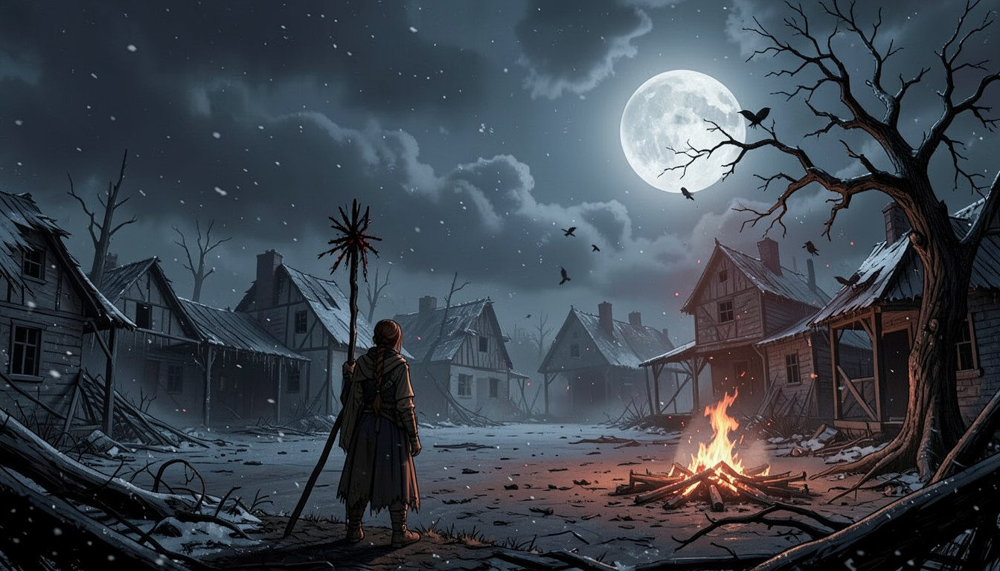
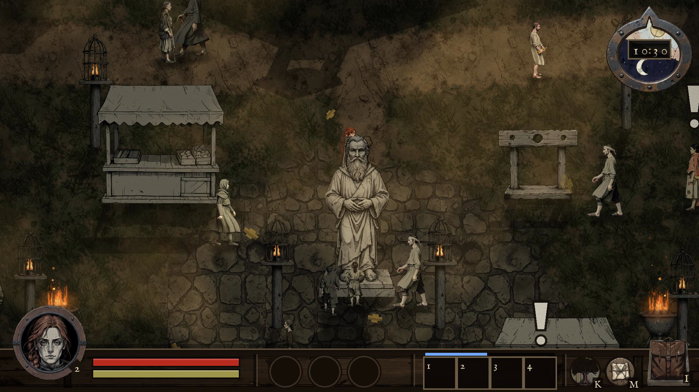
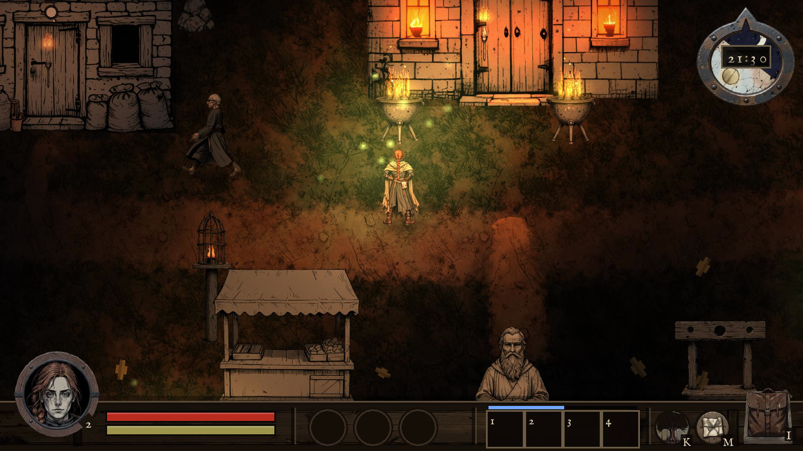
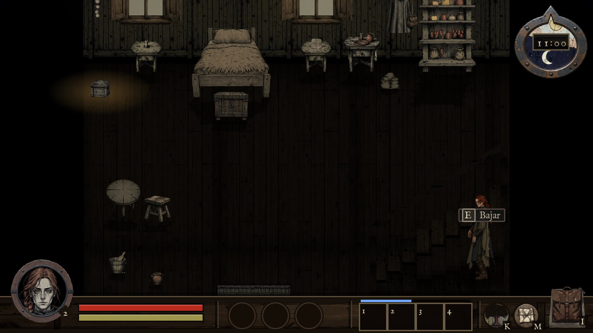
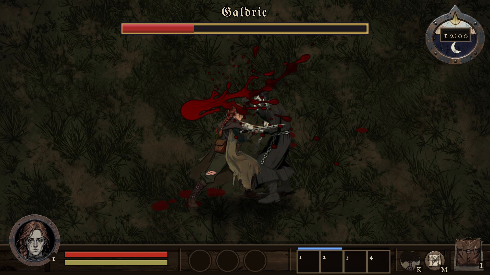
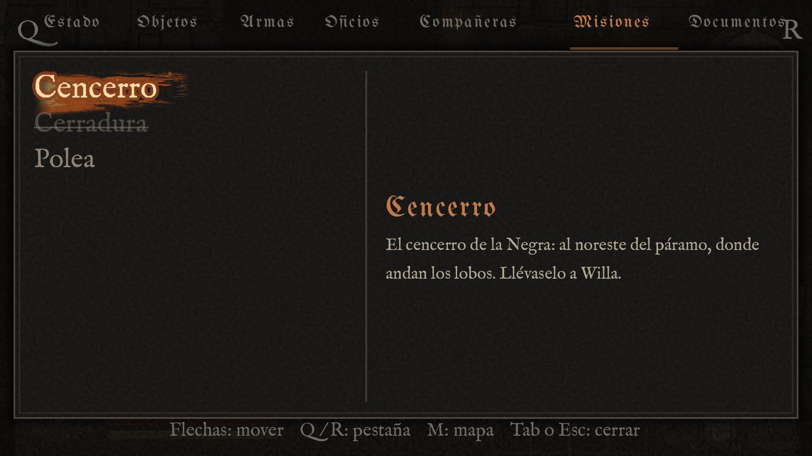
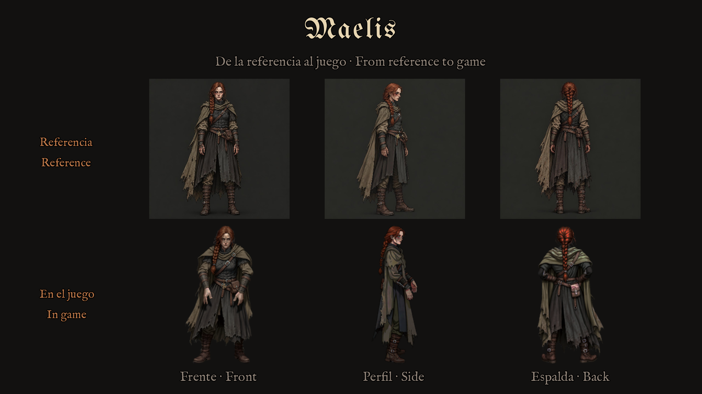
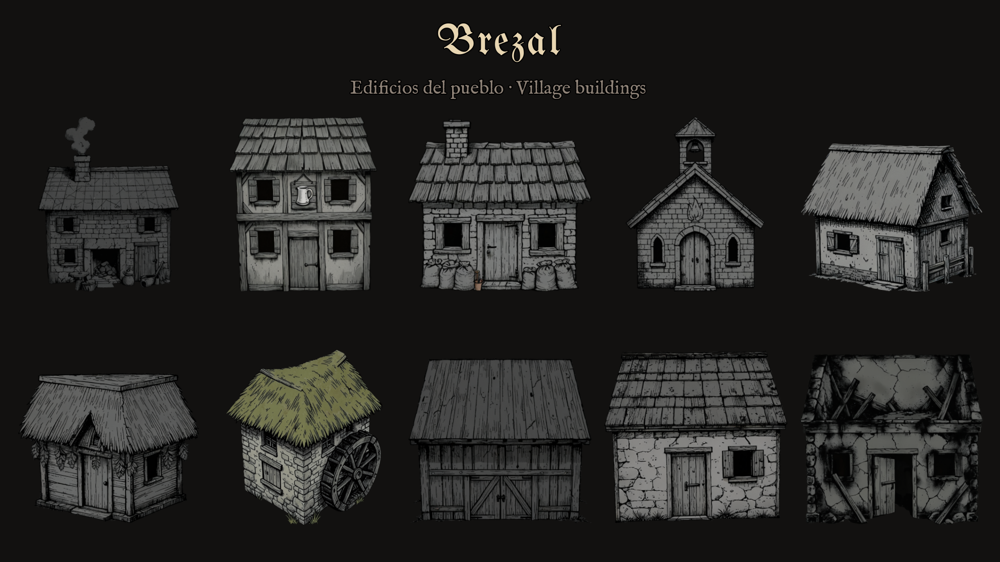
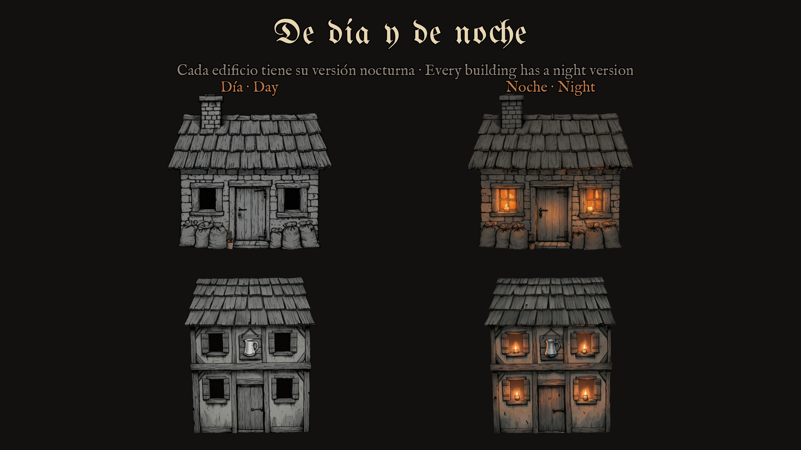

<a href="README.md">Español</a> · <b>English</b>

# Embers Remain

**Valdren, year 312 of the Flame.** Maelis returns to the heath where the pyres burned. A dark exploration and
combat RPG with an ink-illustration look, made in **Godot 4**.

**Status:** the first chapter (Act I) is playable from start to finish. Version 1.0 will include all three acts.

## The game

- **Real-time melee combat:** slash, thrust and kick combo, heavy attack, dodge, block and counter. Every enemy
  attacks and falls in its own way, and bosses have their own phases.
- **A living village:** day and night, weather, quests that change the place, multi-floor interiors, fishing and
  forging.
- **Interface:** floating prompts with the available action ([E] Talk, Climb, Read…), quest and item
  notifications, and finished quests struck through in the inventory.

| By day | By night |
|---|---|
|  |  |
| **Multi-floor interiors** | **Combat** |
|  |  |

## How it was made: human script, AI art and animation

Embers Remain is also an experiment: **how far can you go drawing and animating a whole game with AI when a
person writes the story, the characters and the design?** Everything runs locally on a single PC.

1. **Characters.** Each character is drawn from the script, front view first (FLUX.2 Klein). Only once it is
   approved does the same model, in edit mode, produce the back and side views from that image, so the design
   stays the same.
2. **3D skeleton.** The three views become a T-pose model (Hunyuan3D-2mv + Blender), animated with Mixamo.
3. **Guides.** Blender renders each animation from the game's three cameras as depth and skeleton videos.
4. **Animation.** Wan 2.1 VACE 14B takes the guide and the character image and draws the animation frame by frame.
5. **Review.** Every batch is watched on video; what fails is redone. Approved frames are cut out and go into Godot.

**Videos:** [trailer](media/embers_remain_trailer.mp4) · [walk and run](media/maelis_caminar_y_correr.mp4) ·
[characters](media/personajes_acto1.mp4)

### What we learned

- AI follows a **shape in the guide** far better than a description in the prompt.
- Asking for the other views **from an already approved image** keeps the design; asking from scratch changes it.
- Human review can't be skipped: a good share of what is generated gets redone at least once.

---

© 2026 NONA Studio. All rights reserved. The images, art, text, characters and the names "NONA Studio" and
"Embers Remain" are property of NONA Studio.
